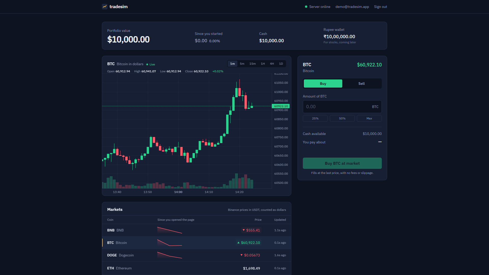

# tradesim

Paper trading for stocks and crypto. Start with virtual money, trade at real market prices with market, limit, stop-loss and bracket orders, and track how your portfolio does, without risking a rupee.



## What's interesting here

- **Money can't go missing.** Every balance change is a double-entry journal entry, and Postgres enforces the rules itself: entries must balance, lines are append-only, and no balance can go below zero. Amounts are integers in the smallest unit, read as `BigInt`, never floats. More in [The ledger](#the-ledger).
- **Retries can't double-charge.** `POST /api/orders` takes an `Idempotency-Key`. A retry with the same key replays the original response byte for byte, and two copies of one request arriving together wait on each other instead of both filling.
- **Open orders hold what they'd spend.** A limit buy moves its cost into a hold account, so two orders can never count on the same cash. A BullMQ worker matches orders on every price tick under row locks with `SKIP LOCKED`, so any number of workers can run, and a fill and a cancel racing for the same order can't both win.
- **Bracket orders that can't fill twice.** When a bracket's buy fills, a take-profit and a stop-loss sell open for the same coins. Whichever fills first cancels the other in the same transaction. Tests race the two children against each other and then check the whole ledger still balances.
- **Live prices.** One Binance WebSocket feeds Redis for every coin, with reconnects and stale-price detection, and the chart shows real candles, with the current one updating live.

## Status

Under active development, one pull request a day. The plan and the reasoning behind it are in [docs/design.md](docs/design.md).

| Feature | State |
| --- | --- |
| Server, web app and CI | Done |
| Postgres schema and migrations | Done |
| Sign-up and login (JWT access tokens, rotating refresh cookies) | Done |
| Double-entry ledger and wallets | Done |
| Live crypto prices from Binance | Done |
| Market orders with idempotency keys | Done |
| Limit, stop-loss and bracket orders | Done |
| Trading screen and candlestick charts | Done |
| Placing limit, stop and bracket orders from the UI | Next |
| Trade history and CSV export | Next |
| Deployment | Planned |
| Watchlists, price alerts, analytics, stocks | Planned |

## Run it

Requires Node 24+ and Docker.

```sh
npm install
cp .env.example .env
docker compose up -d     # Postgres and Redis
npm run migrate          # create or update the tables
npm run dev              # API on http://localhost:4000
npm run dev:web          # app on http://localhost:5173, proxies /api to the server
npm run dev:prices       # live crypto prices from Binance into Redis
npm run dev:orders       # fills limit, stop and bracket orders as prices move
```

## Stack

React, Tailwind and TradingView Lightweight Charts on the front end. Node.js with Express, PostgreSQL, Redis and BullMQ on the back end. The server is TypeScript run directly by Node, so there is no build step.

## Development

```sh
npm test         # database tests need Postgres from docker compose
npm run typecheck
```

Schema changes go in a new file in `server/migrations`, named like `002_short_name.sql`. Each one runs once, in its own transaction. The runner refuses to start if an applied migration has been edited, so fix mistakes with a new migration.

## The ledger

Money and assets only move through journal entries, and the database enforces the rules itself, so a bug in the app can't break them:

- Every entry balances: for each asset, its lines sum to zero. This is checked when the transaction commits.
- Entries and lines are append-only. Updates and deletes are rejected, and mistakes are fixed with a reversing entry.
- A line can't carry a different asset from its account.
- A user's balance can never go below zero.
- Amounts are whole numbers of the smallest unit (paise, cents, or 10⁻⁸ of a coin), and the server reads them as `BigInt`, never as floating point.

## License

MIT
